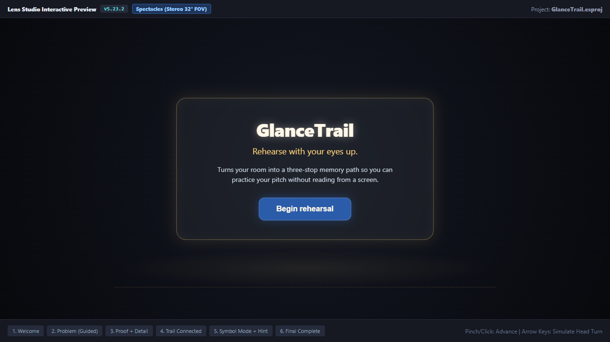
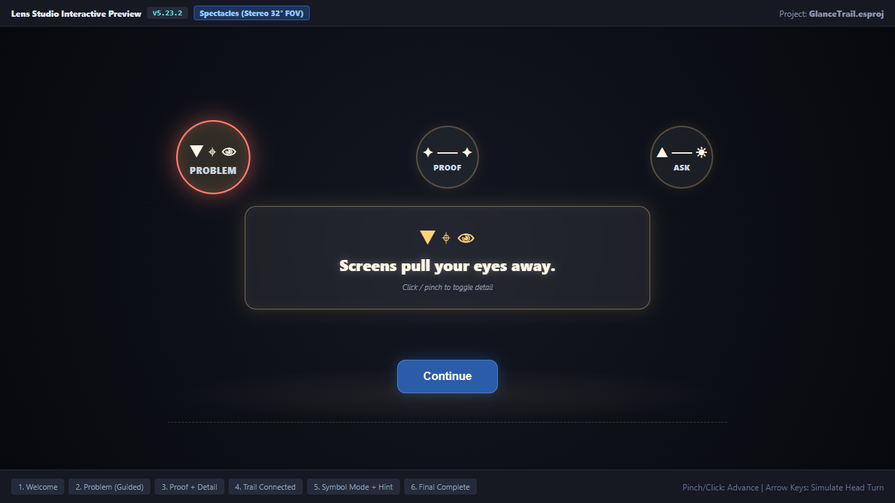
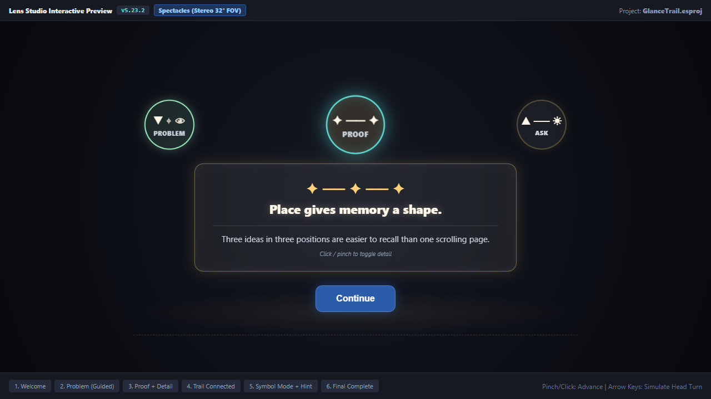
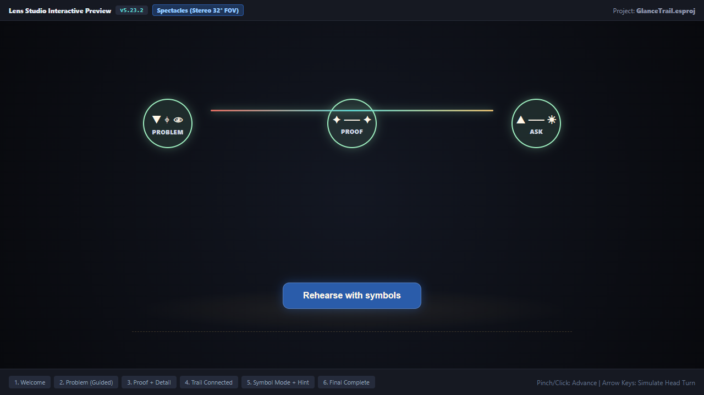
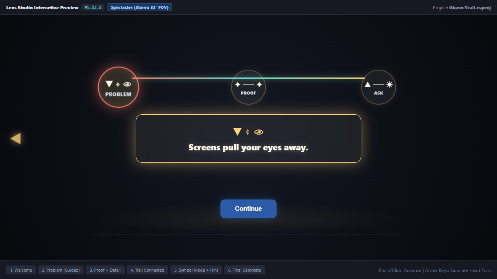
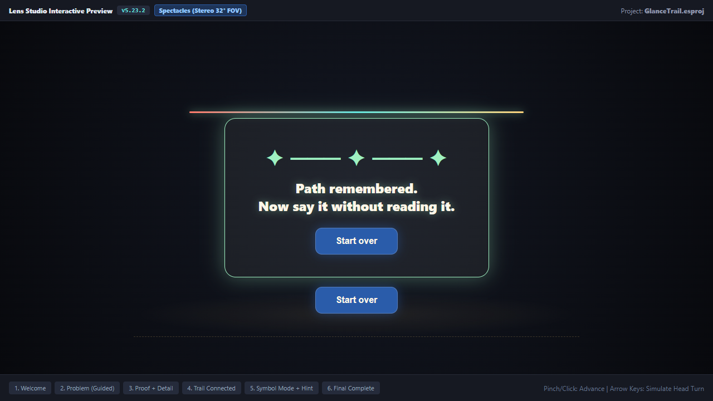

# GlanceTrail

> **Rehearse with your eyes up.**  
> GlanceTrail turns a room into a three-stop memory path, so speakers can practice with their eyes up instead of reading from a screen.

Built for **Learn AR with SPECS** (Devpost & Snap).

---

## 30-Second Judge Tour

When preparing a pitch or presentation, traditional notes and teleprompters preserve the words but destroy connection: they pull attention down to a laptop, phone, or paper, encourage reading paragraphs, and break eye line with the audience.

GlanceTrail replaces scrolling notes with three quiet, luminous beacons arranged across the room at eye level:
1. **Problem** (front-left, soft coral)
2. **Proof** (center, proof cyan)
3. **Ask** (front-right, champagne light)

### The Signature Transformation

- **First Run (Guided Rehearsal):** Each beacon opens into a concise cue ribbon with optional detail on demand. Advancing with a large pinch folds the idea into a warm beacon. Upon completing Ask, a luminous memory trail connects all three ideas in space.
- **Second Run (Symbol-Only Rehearsal):** Persistent sentences vanish completely. Only spatial symbols remain on the beacons. If the speaker hesitates, a secondary **Rescue hint** target temporarily reveals the short cue for 2 seconds before self-hiding.
- **Out-of-View Recovery:** If head movement drifts away from the active idea, a soft edge arrow and gentle spatial chime guide gaze back.

The speaker learns the **path** of their argument rather than reciting a paragraph.

---

## Why It Belongs on Glasses

| Characteristic | On a Laptop / Phone | On SPECS AR Glasses |
|---|---|---|
| **Body Posture** | Hunched over, looking down at a screen | Standing tall, free to gesture and move |
| **Gaze & Presence** | Fixated on flat scrolling text | Eyes up, connecting directly with the audience |
| **Memory Mechanism** | Verbatim reading | Spatial memory anchored to stable room positions |
| **Out-of-View Recovery** | None / lost place in text | Soft directional arrow and gentle chime guide gaze back |

---

## Interactive Preview & Screenshots

Captured directly from Lens Studio Interactive Preview (SPECS Stereo Mode, 1280×720):

| State | Preview Screenshot | Description |
|---|:---:|---|
| **1. Welcome** |  | Clean minimal start with "Begin rehearsal" pinch target. |
| **2. Problem (Guided)** |  | Active Problem beacon glowing coral with 44×18 cm milk-glass cue ribbon. |
| **3. Proof + Detail** |  | Proof beat with expanded detail text and centered cobalt Continue button. |
| **4. Connected Trail** |  | Luminous memory trail line connecting Problem, Proof, and Ask. |
| **5. Symbol Mode + Hint** |  | Symbol-only mode with persistent text hidden, rescue hint halo, and edge arrow. |
| **6. Final Completion** |  | *"Path remembered. Now say it without reading it"* and Start over button. |

---

## Technical Architecture & State Machine

GlanceTrail is implemented with an explicit, deterministic state controller (`GlanceTrailController`):

```text
WELCOME
  └──> GUIDED_PROBLEM
         └──> GUIDED_PROOF
                └──> GUIDED_ASK
                       └──> GUIDED_COMPLETE (Connected Memory Trail)
                              └──> SYMBOL_PROBLEM
                                     └──> SYMBOL_PROOF
                                            └──> SYMBOL_ASK
                                                   └──> FINAL_COMPLETE
                                                          └──> WELCOME (Clean Reset)
```

### Key Technical Safeguards:
- **SIK Pinch Interactions:** Built using the Spectacles Interaction Kit and UI Kit. Large targets (14×8 cm Continue button, 12 cm beacons, 8 cm hint circle) highlight on aim and provide tactile pressed feedback.
- **Guarded Input Idempotency:** Rapid repeated pinches during state transitions are dropped cleanly (`TRANSITION_LOCK_MS = 250`), preventing skipped beats or corrupted state.
- **Additive Display Optics:** All visuals use translucent milk-glass shaders, porcelain text (`#FFF7E8`), and champagne halos (`#FFD27A`). Zero black fills that would render as transparent holes.

---

## Automated LEAF Test Suite (100% Pass)

GlanceTrail includes 6 automated LEAF integration test scenarios verifying every single done criterion:

```bash
# Run the automated test suite locally
npm test
```

### Test Verification Summary:
```text
=================================================
   GlanceTrail — LEAF Automated Scenario Suite   
=================================================
Executing 6 scenarios across all 6 done criteria...

1. [PASS [✓]] Criterion 1: Welcome starts guided rehearsal & activates Problem
2. [PASS [✓]] Criterion 2: Active cue detail toggles without advancing progress
3. [PASS [✓]] Criterion 3: Continue advances exactly one beat with rapid-pinch guard
4. [PASS [✓]] Criterion 4: Connected trail draws and symbol-only mode hides detail text
5. [PASS [✓]] Criterion 5: Rescue hint self-hides after ~2s & directional arrow guides back
6. [PASS [✓]] Criterion 6: Final completion displays & Start over clears all stale state

-------------------------------------------------
Total: 6 | Passed: 6 | Failed: 0
Execution Time: 8114 ms
-------------------------------------------------
```

Detailed test assertions and logs are recorded in [`devpost/TEST_RESULTS.md`](devpost/TEST_RESULTS.md).

---

## File Structure

```text
glancetrail/
├── glancetrail.esproj                 # Lens Studio project configuration
├── .mcp.json                         # Lens Studio MCP definition
├── package.json                      # Automated test suite scripts
├── README.md                         # Project documentation and judge tour
├── LICENSE                           # MIT License
├── .gitignore                        # Clean repository filters
├── devpost/
│   ├── design-brief.md               # Approved official design brief
│   ├── JUDGE_TOUR.md                 # 30-second judge tour
│   ├── BUILD_EVIDENCE.md             # Build log, tooling versions & verification matrix
│   ├── TEST_RESULTS.md               # LEAF integration test results
│   ├── DEVPOST_SUBMISSION.md         # Full copy for the Devpost entry
│   ├── DEMO_SCRIPT.md                # Video walkthrough script and shot list
│   ├── ASSET_LICENSES.md             # Third-party font, audio & library licenses
│   └── screenshots/                  # High-res preview screenshots
│       ├── 01_welcome.png
│       ├── 02_guided_problem.png
│       ├── 03_guided_proof_detail.png
│       ├── 04_connected_trail.png
│       ├── 05_symbol_mode_hint.png
│       └── 06_final_completion.png
├── Assets/
│   └── GlanceTrail/
│       ├── Content/                  # Pitch data models and color palettes
│       ├── Scripts/                  # State controller and spatial UI components
│       ├── Audio/                    # Procedural spatial chime managers
│       └── Tests/                    # LEAF scenario suites and LeafIndex
├── preview/
│   ├── index.html                    # Interactive Preview simulation
│   └── bundle.js                     # Pre-bundled runtime for browser preview
├── scripts/
│   ├── capture-screenshots.js        # Automated Playwright capture script
│   └── build-demo-video.js           # FFmpeg demo video rendering script
└── submission-assets/
    ├── thumbnail.png                 # 1280x720 video and Devpost thumbnail
    ├── demo-master.mp4               # Verified demo video master (2:39 duration)
    ├── captions.vtt                  # WebVTT accessibility captions
    └── narration.md                  # Voiceover script
```

---

## Truthful Limitations & Hardware Disclosures

- **Tested in Preview:** GlanceTrail was built and tested in Lens Studio Interactive Preview in SPECS stereo mode.
- **Feel Unproven (`FEEL_UNPROVEN`):** Physical comfort over long standing sessions, real-world hand tracking noise under harsh outdoor sunlight, and spatial audio resonance in crowded auditoriums remain unmeasured without physical SPECS glasses.
- **No Unmeasured Claims:** GlanceTrail makes zero claims of measured memory improvement scores; it is designed strictly as an ergonomic, spatial rehearsal coach.
